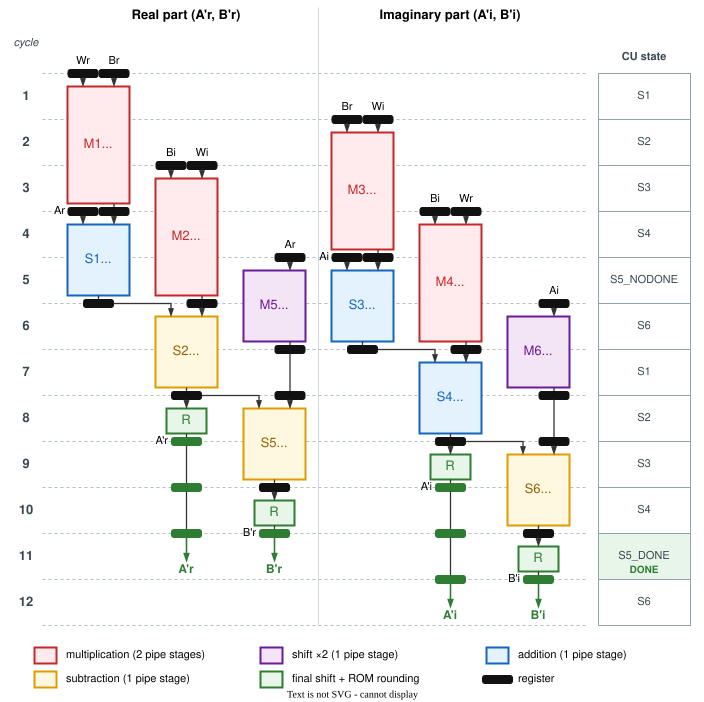
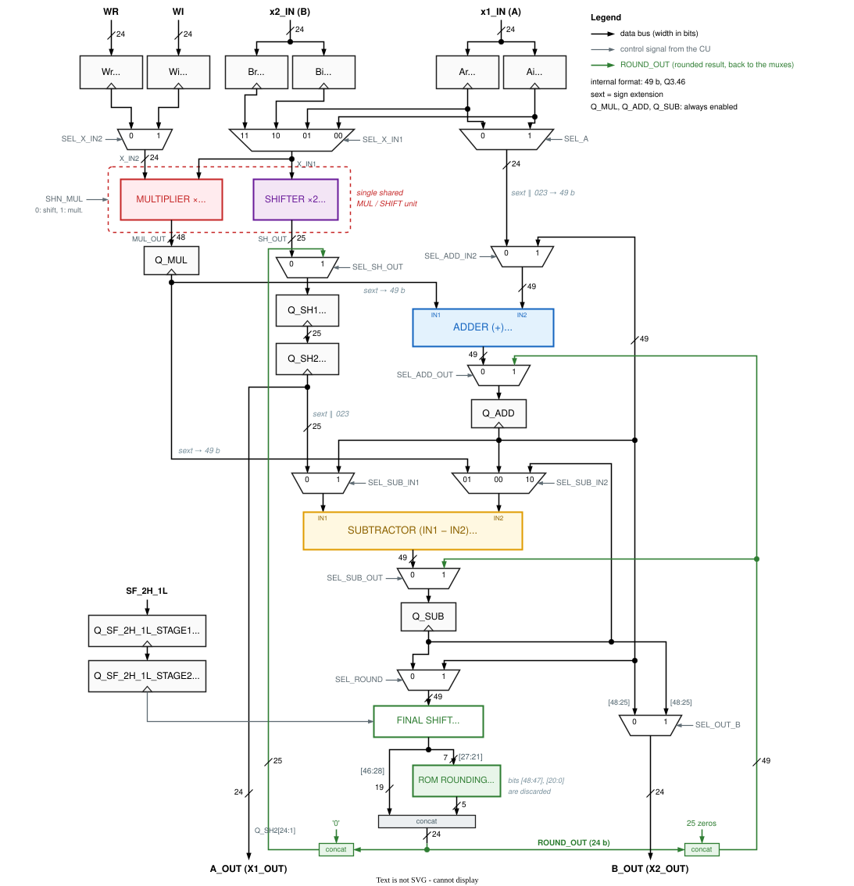
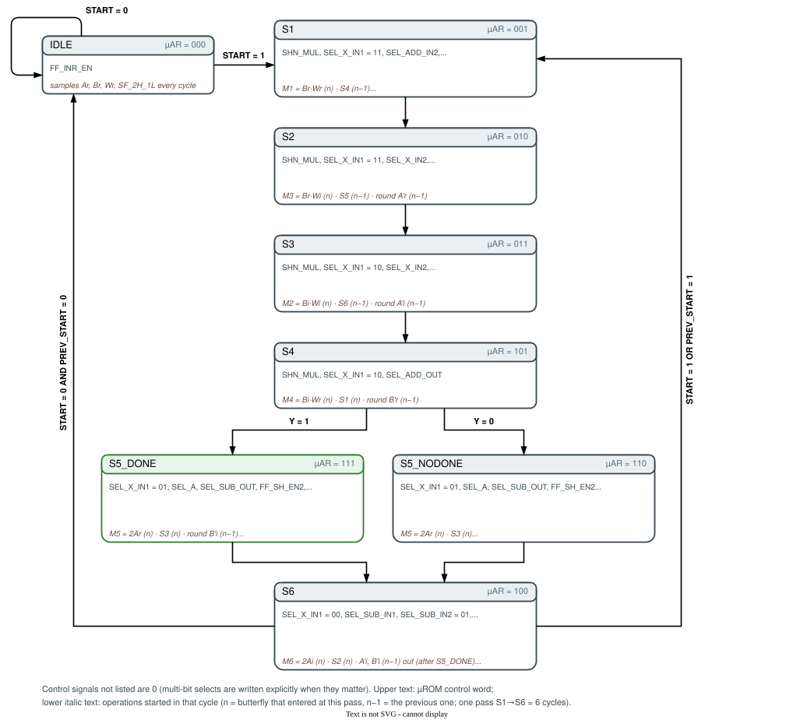
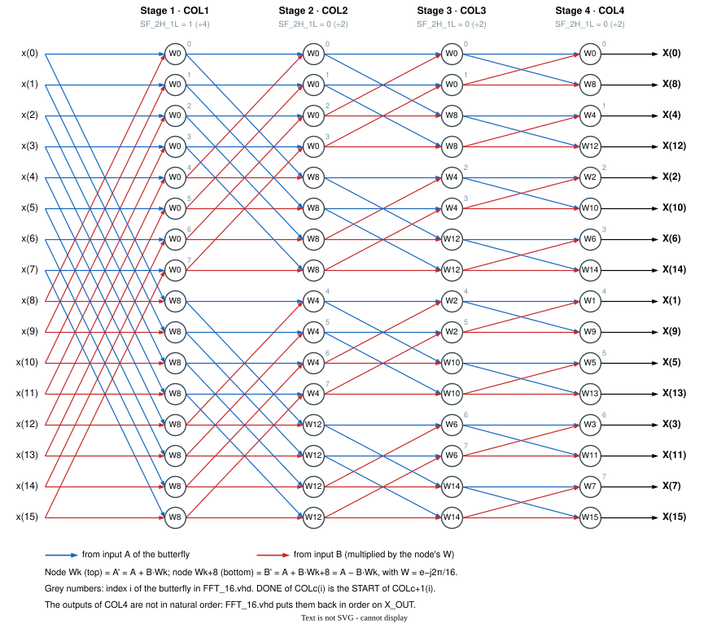

# 16-point FFT on a microprogrammed radix-2 butterfly (VHDL)

Final project for the *Integrated Digital Systems* course (*Sistemi Digitali Integrati*) at Politecnico di Torino, A.Y. 2025/26.
The design is a radix-2 butterfly processing element. It has one shared multiplier/shifter, one adder and one subtractor, and is driven by a microprogrammed control unit that branches with the *late status* technique. 32 instances of the butterfly make a fully parallel 16-point FFT.

**Authors:** Luca Magarotto, Riccardo Moiso

| | |
|---|---|
| Butterfly latency | 11 clock cycles from the edge that samples `START` to the edge that samples `DONE`. The real parts are on the outputs with `DONE`; the imaginary parts follow one cycle later. |
| Butterfly throughput | one butterfly every 6 cycles in continuous mode, with no dead cycles |
| Butterfly hardware | 1 multiplier/shifter, 1 adder, 1 subtractor, a 128 × 5 bit rounding ROM, 6 input registers and 5 internal registers |
| Arithmetic | 24-bit fractional two's complement on the inputs and outputs, 49 bits (Q3.46) inside. Results are rounded only at the outputs (round to nearest even). |
| Control unit | 8 states; a 2 × 4 × 23 bit µROM split into even and odd banks; Late Status PLA |
| FFT-16 | 4 columns × 8 butterflies, latency 44 cycles (+1 for the imaginary parts), one new FFT every 6 cycles |

---

## The assignment

In short, the task was to design a radix-2 butterfly in VHDL, driven by a microprogrammed control unit, and then to use it to build a 16-point FFT.
The butterfly works on the complex numbers A, B and W<sup>k</sup>:

```
A' = A + B·W^k
B' = A − B·W^k
```

The main constraints were:

- **Numbers:** real and imaginary parts are 24-bit fractional two's-complement numbers. The outputs are always scaled down by 1 or 2 bits, chosen by the input `SF_2H_1L`, so they stay in (−1, 1).
- **Hardware:** only one multiplier (it can also work as a ×2 shifter), one adder and one subtractor, all with internal pipeline stages.
- **Precision:** no truncation inside the datapath. The results are rounded only at the end, with a ROM (round to nearest even).
- **I/O:** a `START`/`DONE` handshake. The unit must work both for a single butterfly and for a continuous stream of butterflies with no dead cycles, and it must find out the mode by itself.
- **Control unit:** microprogrammed, with an explicit sequencer and the *late status* technique.
- **FFT-16:** the butterflies of the first stage scale by 2 bits, all the others by 1 bit.

---

## Our solution in brief

### Butterfly

- **Schedule.**
    - The multiplier is busy in every cycle of a 6-cycle pass: B<sub>r</sub>W<sub>r</sub>, B<sub>r</sub>W<sub>i</sub>, B<sub>i</sub>W<sub>i</sub>, B<sub>i</sub>W<sub>r</sub>, 2A<sub>r</sub>, 2A<sub>i</sub>.
    - Additions and subtractions run in cycles 4–9, and the four roundings in cycles 8–11.
    - Computing B' = 2A − A' means only 3 additions and 3 subtractions are needed.

    <p align="center"></p>

- **Datapath.**
    - There are 6 input registers and 5 internal registers (`Q_MUL`, `Q_SH1`, `Q_SH2`, `Q_ADD`, `Q_SUB`). The internal registers are reused to hold the rounded results, and 5 is the minimum given by the variable lifetimes.
    - All internal arithmetic is done on 49 bits.
    - The output stage is a final shift by 1 or 2 bits followed by ROM rounding. The ROM address is the 5 result LSBs plus 2 guard bits; the ROM saturates instead of propagating a carry, with a mean error of −1/64 LSB.

    <p align="center"></p>

- **I/O.**
    - A<sub>r</sub>, B<sub>r</sub> and W<sub>r</sub> are sampled with `START`; A<sub>i</sub>, B<sub>i</sub> and W<sub>i</sub> one cycle later. A and B use the same ports (`x1_IN`, `x2_IN`) for both parts; W has its own ports (`WR`, `WI`).
    - The outputs come out in the same order: A'<sub>r</sub> and B'<sub>r</sub> with `DONE`, then A'<sub>i</sub> and B'<sub>i</sub>. The `DONE` of one butterfly can therefore drive the `START` of the next.
- **Control unit.**
    - States: IDLE, S1–S4, S5_DONE / S5_NODONE, S6.
    - The µAR is clocked on the falling edge and the µIR on the rising edge. The Late Status PLA is a 4:1 multiplexer driven by the 2-bit `CC` field.
    - Each pass S1→S6 starts a new butterfly and completes the previous one. A `START` during S6 puts the machine in continuous mode.
    - Two internal flags handle the rest: `PREV_START` says whether another pass is needed, and `Y` says whether the results shown in S5 are valid.

    <p align="center"></p>

### FFT-16

- Four columns of 8 butterflies take the input in natural order. The last column produces the results in bit-reversed order and the top level re-orders them, so `X_OUT` is in natural order, with X = DFT(x)/32.
- The `DONE` of column *c* is the `START` of column *c*+1.

<p align="center"></p>

---

## Report

The full report, in Italian, is [`report/report.pdf`](report/report.pdf). It explains every design step and shows the simulations.
Its LaTeX sources and all its figures are in [`report/latex`](report/latex).

## Figures

All the figures of the report are in [`figures/`](figures), as SVG files. They were drawn with draw.io; the report uses the same figures as PDF.

| # | Figure | # | Figure |
|---|---|---|---|
| 01 | [DFD and schedule of one butterfly](figures/fig01_dfd_butterfly.svg) | 08 | [Microprogrammed control unit](figures/fig08_cu_microprogrammed.svg) |
| 02 | [DFD in continuous mode + reservation table](figures/fig02_dfd_continuous.svg) | 09 | [Late Status PLA](figures/fig09_late_status_pla.svg) |
| 03 | [Butterfly datapath](figures/fig03_datapath.svg) | 10 | [FFT-16 signal-flow graph](figures/fig10_fft16.svg) |
| 04 | [CU state diagram](figures/fig04_state_diagram.svg) | 11 | [Variable lifetime and register allocation](figures/fig11_variable_lifetime.svg) |
| 05 | [`FF_INI_EN` generation](figures/fig05_ff_ini_en.svg) | 12 | [Single vs continuous operation (timing)](figures/fig12_single_vs_continuous.svg) |
| 06 | [`PREV_START` logic](figures/fig06_prev_start.svg) | 13 | [Microinstruction and `VETT_OUT` format](figures/fig13_microword_vett_out.svg) |
| 07 | [`Y` and `DONE` logic](figures/fig07_y_done.svg) | 14 | [µROM contents](figures/fig14_urom_contents.svg) |

## Repository structure

```
├── rtl/              VHDL sources (butterfly datapath and CU, µROM, ROM rounding, FFT_16 top level)
├── tb/               testbenches
├── figures/          all the figures of the report, as SVG
├── report/
│   ├── report.pdf    final report (Italian)
│   └── latex/        LaTeX sources of the report: main.tex, sections/, figures/
└── README.md
```

| RTL file | Content |
|---|---|
| `my_types_pkg.vhd` | array types `S_array` (arrays of `signed`) and `INT_array` |
| `ADDER.vhd`, `SUBTRACTOR.vhd` | 49-bit adder and subtractor, 1 pipeline stage each |
| `MULTIPLIER.vhd` | shared multiplier (2 pipeline stages) / ×2 shifter (1 pipeline stage) |
| `MULTIPLEXER_N.vhd`, `MULTIPLEXER_N_SLV.vhd` | generic multiplexers (`signed` and `std_logic_vector` data) |
| `Reg.vhd`, `REG_NxM.vhd` | single flip-flop; bank of registers with one load enable each |
| `Reg_N_Rising.vhd`, `Reg_N_Falling.vhd` | µIR (rising edge, resets to the IDLE word) and µAR (falling edge) |
| `uROM.vhd`, `LSPLA.vhd`, `CU_uROM.vhd` | µROM (even/odd banks), Late Status PLA, control unit |
| `ROM_ROUNDING_COMP.vhd` | 128 × 5 bit rounding ROM |
| `BUTTERFLY_DATAPATH.vhd`, `BUTTERFLY.vhd` | butterfly datapath; butterfly top level (CU + datapath) |
| `FFT_16.vhd` | FFT-16 top level (4 columns of 8 butterflies) |

| Testbench | What it tests |
|---|---|
| `TB_FFT_16.vhd` | full FFT: the 6 test vectors of the report (single and continuous mode), then one test with complex inputs and one synchronous reset during a computation |
| `TB_BUTTERFLY.vhd` | one butterfly: 4 tests with complex A, B, W in continuous mode |
| `TB_CU_uROM.vhd` | control unit alone: state sequence and control vector, single and continuous mode |
| `TB_MULTIPLIER.vhd` | multiplier (A·B) and shifter (2·A) |
| `TB_ADDER_SUBTRACTOR.vhd` | adder and subtractor, same inputs (A + B, A − B) |

## Simulation

The code uses VHDL-2008, so turn on VHDL-2008 in your simulator.
Each testbench gives a set of inputs to one block, or to the full FFT. There are no automatic checks: you look at the waveforms and compare them with the expected results, written in the comments of each testbench (in decimal and in hex).
